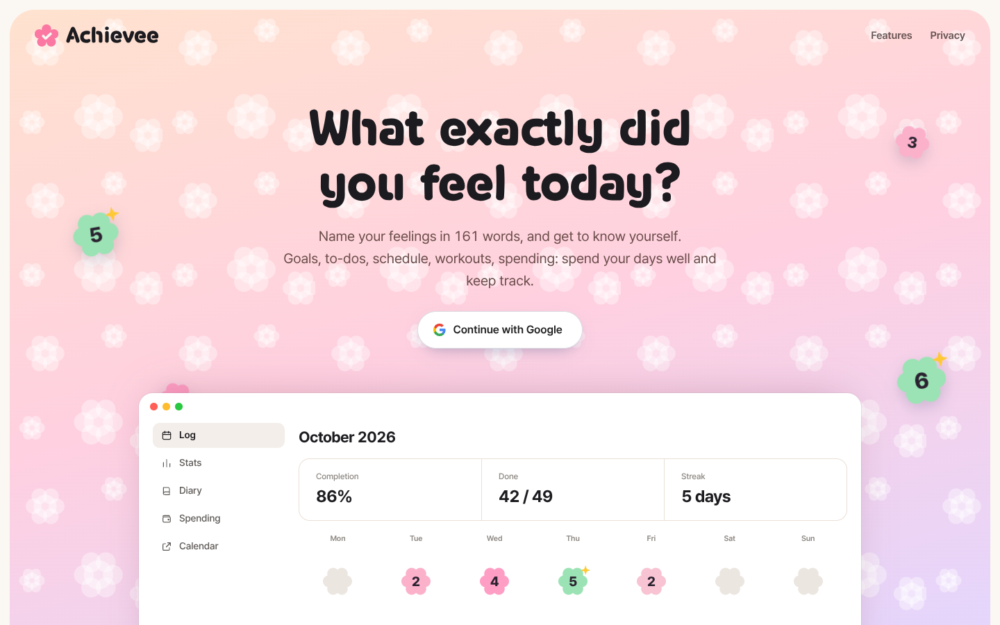

# Achievee

A daily tracker that puts goals, to-dos, calendar, workouts, spending and a diary on one screen.
The diary helps you name what you felt from 161 emotion words. Available in English, Korean, Japanese, Spanish and Traditional Chinese.



## Install

Next.js app with Google sign-in and Postgres (Neon).

```sh
cp .env.example .env.local   # fill in the values
npm install
npm run dev
```

You need a Google OAuth client (enable the Calendar and Tasks APIs) and a Postgres `DATABASE_URL`. `.env.example` lists every variable and the redirect URIs to add. To deploy, connect the repo to Vercel and set the same variables.

## Structure

```
src/app/         pages and API routes
src/components/  UI
src/lib/         auth, database, encryption, emotions, i18n, integrations
public/          icons and fonts
```

## Credits

The emotion words, descriptions and tags are written for this project (`src/lib/emotions.ts`). The idea of widening emotion vocabulary was inspired by [EVOKE](https://arxiv.org/abs/2602.10414) (Jung, Shin and Bergen, 2026); no dataset is included. Logo font: Hakgyoansim Dunggeunmiso (SIL OFL 1.1).
